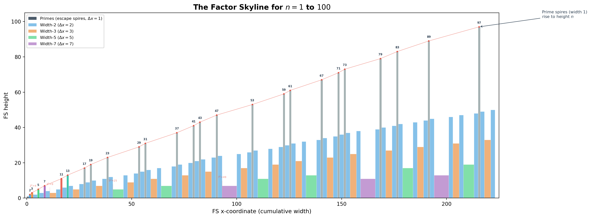
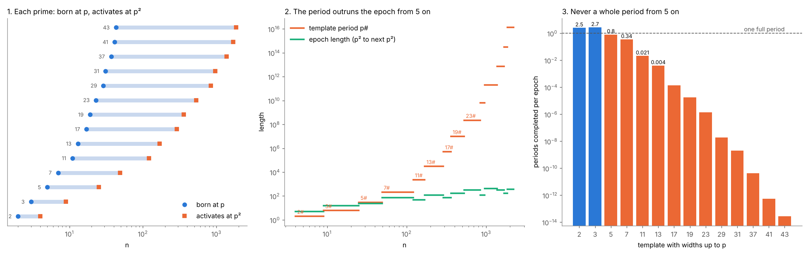

# The Factor Skyline

### A coordinate system that stands each integer up by its least prime factor — what it shows, what it proves, and where it stops

Allen Proxmire

---

## Summary

Each integer $n$ becomes a column of width $\mathrm{lpf}(n)$ and height $n/\mathrm{lpf}(n)$. Primes escape to the diagonal; composites fall onto a fan of rays, one per least prime factor; even numbers form the top ray. Facts that look unrelated on the number line become one picture.

What the lens supplies:
- an elementary account of prime constellations — survival factors, the singular series as a product of survival ratios, and candidates that never run out (§3);
- the reason the wheel is never seen to repeat: from $p \ge 5$ its period outruns the window in which it applies — and the measured leftover that no finished template copies (§4);
- an information budget for the escape layer: simple to generate, random to look at (§5);
- the escape ridge, of order $N^{3/2}/\ln^2 N$ (§6).

What it does not supply: proofs of the classical theorems it pictures (§7), or anything past the parity barrier (§8).

---

## 1. Coordinates

For $n \ge 2$ let $\mathrm{lpf}(n)$ be the least prime factor ($\mathrm{lpf}(1) = 1$). Column $n$ has width $w(n) = \mathrm{lpf}(n)$ and height $h(n) = n/\mathrm{lpf}(n)$. Placed side by side,
$$x_{FS}(n) = x_{FS}(n-1) + dx(n), \qquad dx(n) = \begin{cases} 1 & n \text{ prime} \\ \mathrm{lpf}(n) & n \text{ composite} \end{cases}, \qquad y_{FS}(n) = \begin{cases} n & n \text{ prime} \\ n/\mathrm{lpf}(n) & n \text{ composite.} \end{cases}$$

| $n$ | 2 | 3 | 4 | 5 | 6 | 7 | 8 | 9 | 10 | 11 | 12 | 13 | … | 25 | … | 29 | 30 |
|---|---|---|---|---|---|---|---|---|---|---|---|---|---|---|---|---|---|
| $x_{FS}$ | 2 | 3 | 5 | 6 | 8 | 9 | 11 | 14 | 16 | 17 | 19 | 20 | | 46 | | 54 | 56 |
| $y_{FS}$ | 2 | 3 | 2 | 5 | 3 | 7 | 4 | 3 | 5 | 11 | 6 | 13 | | 5 | | 29 | 15 |

Plotted as $n$ against $y_{FS}(n)$: primes sit on the **escape diagonal** $y = n$; a composite with least prime factor $p$ sits on the **ray** $y = n/p$. The width-2 ray holds every even number — the home of doubling ($2p$, consecutive-prime sums, twin sums). The lower rays are the wheel. A number is prime iff it dodges every ray and reaches the diagonal.

---

## 2. Activation, coverage, escape

- **Activation.** Width $p$ first appears at $p^2$, the least $n$ with $\mathrm{lpf}(n) = p$. The **epoch** $[p_k^2, p_{k+1}^2)$ is the stretch on which the set of active widths is fixed.
- **Horizon.** A composite $n \le N$ has $\mathrm{lpf}(n) \le \sqrt N$, so only widths up to $\sqrt N$ act at scale $N$.
- **Template.** Which width claims $n$, among primes $\le p_k$, depends only on $n \bmod p_k\#$. The template has $\varphi(p_k\#) = p_k\#\prod_{i\le k}(1 - 1/p_i)$ open positions — for $5\# = 30$, the eight $\{1, 7, 11, 13, 17, 19, 23, 29\}$.
- **Width counts are fixed.** In every $p_k\#$-period the number of width-$q$ columns is $\frac{p_k\#}{q}\prod_{r<q}(1 - 1/r)$.

---

## 3. Constellations

For a $k$-tuple $H = \{h_1, \dots, h_k\}$ let $v_q(H)$ be the number of residues mod $q$ it occupies; $H$ is **admissible** if $v_q(H) < q$ for every $q$.

**Survival.** When width $q$ activates, a fraction $S_q(H) = (q - v_q(H))/q$ of the constellation-open positions survives.

**Coverage protection.** If $q \mid r + h_i$ then $q \nmid r + h_j$ for every $h_j \not\equiv h_i \pmod q$: a layer that removes one member spares the members in other residue classes.

**The constant is the singular series.** Define
$$C_H = \prod_q \frac{S_q(H)}{(1 - 1/q)^k} = \prod_q \frac{q^{k-1}(q - v_q(H))}{(q-1)^k}.$$
This is the Hardy–Littlewood singular series of $H$. For twins, $v_2 = 1$ and $v_q = 2$ for odd $q$, so
$$C_{\{0,2\}} = 2\prod_{q > 2}\frac{q(q-2)}{(q-1)^2} = 2C_2 = 1.3203\ldots$$
and every pair has $C_{\{0,h\}} = 2C_2\prod_{p \mid h,\ p>2}\frac{p-1}{p-2} \ge 2C_2 > 1$.

| pattern | $C_H$ |
|---|---|
| twin $(0,2)$ | 1.3203 |
| cousin $(0,4)$ | 1.3203 |
| sexy $(0,6)$ | 2.6406 |
| triplet $(0,2,6)$ | 2.8581 |
| quadruplet $(0,2,6,8)$ | 4.1511 |

$C_H > 1$ for every admissible tuple checked (all pairs, by the formula; random admissible triples and quadruples, minimum 2.858). A general proof for $k \ge 3$ is not given here.

**Template persistence.** Extending the template from $p_k\#$ to $p_{k+1}\#$ copies each open position $p_{k+1}$ times and removes $v_{p_{k+1}}(H)$ of the copies:
$$N_H(p_{k+1}) = N_H(p_k)\,\bigl(p_{k+1} - v_{p_{k+1}}(H)\bigr).$$

| $p_k\#$ | 2 | 6 | 30 | 210 | 2310 | 30030 |
|---|---|---|---|---|---|---|
| twin-open | 1 | 1 | 3 | 15 | 135 | 1485 |
| triplet-open | 1 | 1 | 2 | 8 | 64 | 640 |
| quadruplet-open | 1 | 1 | 1 | 3 | 21 | 189 |

For admissible $H$ the count never falls and tends to infinity: the template supplies ever more candidates. Whether any is filled is the escape layer's business.

**Footprints.** A twin pair $p, p+2$ with $p \ge 5$ always has $x_{FS}(p+2) - x_{FS}(p) = 3$ (the one integer between is even). Triplets $(0,2,6)$ have footprint $[3, 8]$ and quadruplets $(0,2,6,8)$ $[3, 8, 3]$ in every instance below 500.

---

## 4. Epochs outrun the template

At activation threshold $p_k$ the governing template has period $p_k\#$, but the epoch in which that template applies has length only $p_{k+1}^2 - p_k^2$:

| $p$ | $p\#$ | epoch length | periods per epoch |
|---|---|---|---|
| 2 | 2 | 5 | 2.50 |
| 3 | 6 | 16 | 2.67 |
| 5 | 30 | 24 | 0.80 |
| 7 | 210 | 72 | 0.34 |
| 11 | 2310 | 48 | 0.02 |
| 13 | 30030 | 120 | 0.004 |

**From $p \ge 5$ the template never completes one period inside the epoch where it is the operative rule.** Each new width multiplies the period by $p_{k+1}$ while the epoch grows only like $p$. A fully determined, cheaply described pattern is structurally unable to look periodic where it applies.

Each prime has two moments: it is **born** at $p$ (Bertrand places one in every $(p, 2p)$) and **activates** at $p^2$. The period grows like $e^{p}$, the epoch like $p$:
$$\text{periods per epoch} = \frac{p_{k+1}^2 - p_k^2}{p_k\#} \qquad (0.8,\ 0.34,\ 0.02,\ 0.004,\ 1.4\times10^{-4},\ \dots \text{ from } p = 5).$$

**What no finished template copies.** A template finished at modulus $Q$ — integers coprime to every prime $\le Q$, thinned to prime density — is a fair model only while it stays weaker than the primes (pool ratio above $\approx 1.25$, [Null Model Discipline §4](../2_One_Wheel_Many_Shadows/Null_Model_Discipline.md)). The test: cut $[5\times10^6, 5\times10^7]$ into windows, take the total width of the wide columns ($p > N^{1/3}$, each a product $p\cdot q$ of two primes) in each window, remove the trend, and correlate neighbouring windows.

| windows | primes | template to 13 | to 23 | to 31 | to 41 |
|---|---|---|---|---|---|
| pool ratio (near-square zone) | 1.00 | 1.62 | 1.38 | 1.27 | 1.19 |
| $10^5$ | −0.26 | +0.05 | −0.02 | −0.06 | −0.08 |
| $2\times10^5$ | −0.31 | +0.21 | +0.18 | +0.15 | +0.11 |

Neighbouring windows alternate, 3 to 4.5σ beyond every fair template, with no convergence as $Q$ deepens; the template to 41, already past the fair line, still falls short.

The alternation is inherited from the cofactors $q$: prime counts in neighbouring short intervals of length $L$ anticorrelate beyond the template, in sign and rough size as Montgomery and Soundararajan derive from the Hardy–Littlewood conjectures,
$$\rho \approx -\frac{\ln 2}{2\bigl(\ln(q/L) + B\bigr)}, \qquad B = 1 - \gamma - \ln 2\pi.$$

| cofactors $q$ | $L$ | primes | template to 31 | prediction |
|---|---|---|---|---|
| $[2000, 8000)$ | 200 | −0.30 | +0.05 | −0.22 |
| $[8000, 40000)$ | 60 | −0.13 | −0.04 | −0.08 |
| $[40000, 135000)$ | 200 | −0.12 | +0.04 | −0.08 |

The singular series behind it is a product over every prime (§3). Each finished template holds only a finite part of it; the epoch moves on before any template completes. → [`active_template.py`](repro/active_template.py)

---

## 5. Simple to generate, random to look at

**The information budget.** For the step sequence $dx(n)$ at $N = 10^4$,
$$H(dx) = 2.48 = \underbrace{1.70}_{\text{template}} + \underbrace{0.26}_{\text{escape}} + \underbrace{0.52}_{\text{activation}} \text{ bits per integer}.$$
The template's 1.70 bits holds across three decades (1.694 → 1.700). The escape peaks near $10^4$ and declines slowly (0.254 → 0.225 from $10^3$ to $3\times10^6$). Activation — which least prime factor a composite has — grows without bound (0.25 → 1.04), so the template's *share* of $H$ is range-specific (68% at $10^4$, 59% at $10^6$). The mod-30 wheel removes 73.3% of positions; an open slot still carries $\approx 0.84$ bits. → [`entropy_budget.py`](repro/entropy_budget.py)

**Simple and random at once.** The first $N$ escape indicators are produced by a sieve program of size $O(\log N)$, yet carry about $0.26$ bits per integer of measured entropy at $N = 10^4$:
$$K = O(\log N) \qquad\text{against}\qquad H \approx 0.26\,N .$$
A short rule whose output is statistically indistinguishable from noise is the definition of pseudo-randomness; together with §4 it is the whole account of why the primes look random while the rule is trivial to state.

---

## 6. The escape ridge

Plot each prime at $(x_{FS}(p),\ p)$. Summing the steps, composites with least prime factor $p$ exist only for $p \le \sqrt N$ (activation), each contributes $p$, and there are about $\frac Np\prod_{q<p}(1 - \frac1q)$ of them, so
$$x_{FS}(N) \approx N\sum_{p \le \sqrt N}\prod_{q<p}\Bigl(1 - \frac1q\Bigr) \sim 4e^{-\gamma}\,\frac{N^{3/2}}{\ln^2 N}, \qquad\text{hence}\qquad y \sim X^{2/3}(\ln y)^{4/3}.$$
The extra $\sqrt N$ is the $p^2$ activation. The order is right — the local exponent climbs 1.18, 1.17, 1.24, 1.29, 1.33 from $10^2$ to $10^6$ toward $\frac32$, and the ridge power falls 0.85, 0.81, 0.78, 0.75 toward $\frac23$. The constant is heuristic: the ratio $x_{FS}\ln^2 N/N^{3/2}$ is 4.9 near 500 and 3.2 at $10^7$, still descending.

---

## 7. Classical results, pictured

The lens restates the main facts of multiplicative number theory as features of the picture. These are classical theorems seen in skyline terms, not new proofs of them:

| classical fact | on the skyline |
|---|---|
| $\pi(N) \asymp N/\ln N$ | escapes surviving the layers $q \le \sqrt N$ |
| $\theta(x) = \sum_{p\le x}\ln p \sim x$ (Chebyshev, PNT) | escape log-height accrues at unit rate per integer |
| Mertens: $\prod_{q\le p}(1 - 1/q) \sim e^{-\gamma}/\ln p$ | the escape density after width $p$ |
| squarefree density $6/\pi^2$; Möbius cancellation | width-parity of distinct-width columns |
| Dickman $\rho(u)$ for smooth numbers | activation depth $u = \ln x/\ln \mathrm{gpf}(n)$ |
| Erdős–Kac for $\omega(n)$ | a sum of nearly independent width indicators |
| $\overline{\tau} \sim \ln N$, $\overline{\sigma(n)/n} \to \pi^2/6$ | sub-column selections |

**A caution the picture makes vivid.** Treating the layers $q \le \sqrt N$ as independent gives $N\prod_{q\le\sqrt N}(1 - 1/q) \sim 2e^{-\gamma}N/\ln N \approx 1.123\,N/\ln N$ — the wrong constant (Mertens' paradox). The layers are not independent that far up, and that failure is exactly why sieve heuristics cannot prove the prime number theorem. Independence (the Chinese Remainder Theorem) is exact for the template at a fixed modulus; it is a heuristic beyond it.

---

## 8. Where it stops

The template is proved; the escape is not. Every hard question becomes a statement about the escape layer — twin primes (a footprint of 3 recurring forever), Goldbach (an escape pair aligned about every even $2n$), the $k$-tuple conjecture (every admissible footprint recurring), Legendre (an escape in every $[n^2, (n+1)^2)$), the Riemann hypothesis (escape fluctuations of size $\sqrt x$). Sieve methods built from coverage cannot separate a prime from a product of two primes — the parity barrier — so the lens organizes these problems without moving them.

---

## Ledger

**Classical:** least prime factor, Bertrand's postulate, the Montgomery–Soundararajan short-interval variance (conditional on Hardy–Littlewood), the sieve, the Chinese Remainder Theorem, the singular series, Mertens, the prime number theorem and everything in §7.

**Contributed:** the coordinate system and its picture; the singular series read as a product of survival ratios, with template persistence; the epoch/period comparison of §4 and the fair-template test of its leftover; the information budget of §5; the escape ridge.

## Reproduction

[`repro/entropy_budget.py`](repro/entropy_budget.py) — the information budget at $10^3$ to $3\times10^6$ (standard library).

[`repro/active_template.py`](repro/active_template.py) — the §4 figure and the fair-template test at $5\times10^7$ (numpy, matplotlib; under a minute).

## References

- G. H. Hardy, J. E. Littlewood, *Partitio numerorum III*, Acta Math. **44** (1923).
- H. L. Montgomery, K. Soundararajan, *Primes in short intervals*, Commun. Math. Phys. **252** (2004).
- F. Mertens, *Ein Beitrag zur analytischen Zahlentheorie*, J. reine angew. Math. **78** (1874).
- A. Proxmire, *The Factor Skyline*, Zenodo (2026), DOI [10.5281/zenodo.18275273](https://doi.org/10.5281/zenodo.18275273).
