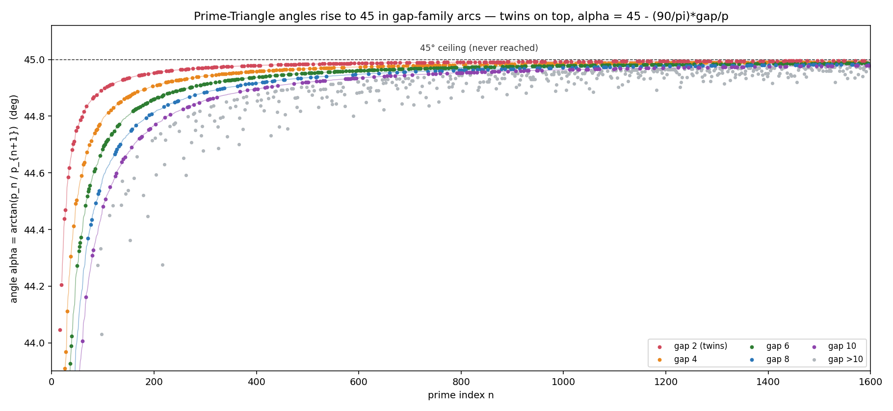

# Gap Correlations

### The prime-triangle angle, gap memory, and the balance ratio — every correlation between consecutive gaps, and all of it the wheel

Allen Proxmire

---

## Summary

- The prime-triangle angle is a rescaled gap: $\alpha_n \approx 45° - \frac{90}{\pi}\frac{g_n}{p_{n+1}}$ (§1).
- Its wobble is ~99% what differencing does to any sequence (§2).
- What is genuinely prime: a lag-1 anti-correlation $\mathrm{corr}(g_n, g_{n+1}) \approx -0.05$ and a windowed excess of $+1.97$ pp — both reproduced in full by a wheel-only model (§3–§4).
- The balance ratio $K = (a^2+b^2+c^2)/(a+b+c)^2$ is an exact gap identity, its 3-divisibility is the mod-6 repeat, and its deviation from chance is the gap covariance by definition. No prime–lepton link (§5).

Methods — the matched null, pool ratios, power checks — are set out in [The Null-Model Discipline](Null_Model_Discipline.md). Range throughout: the 269,991 gaps in $[10^6, 5\times10^6]$ (mean 14.81, sd 12.29) unless stated.

---

## 1. The angle is a rescaled gap

Assign each consecutive pair the angle $\alpha_n = \arctan(p_n/p_{n+1})$. With $p_n/p_{n+1} = 1 - g_n/p_{n+1}$ and $\arctan(1-\varepsilon) = \frac\pi4 - \frac\varepsilon2 + O(\varepsilon^2)$,
$$\alpha_n \approx 45° - \frac{90}{\pi}\cdot\frac{g_n}{p_{n+1}} .$$
So the angles rise toward $45°$ in **gap-family arcs**, one curve per gap value, twins on top.



**The ceiling.** $p_n < p_{n+1}$ makes $\alpha_n < 45°$ strictly. The band sits below it at mean distance $\frac{90}{\pi}\frac{\log p}{p}$: $0.46°$ near $p \sim 300$, $0.0003°$ near $1.6\times10^6$. The top of the band is the twins — see [Twin Bertrand §2](../3_Twin_Bertrand_Prime_Geometry/Twin_Bertrand.md).

**A 52/48 lean.** $\Delta\alpha_n$ is up 52% of the time. The excess is the ~4% of steps where the gap repeats: the same gap on a larger prime is a tighter triangle.

---

## 2. The wobble is universal

Differencing gives $\Delta\alpha_n \approx -\frac{90}{\pi}\frac{\Delta g_n}{p_n}$. Three generic features:

- **Envelope:** $\mathrm{RMS}(\Delta\alpha) \approx 33\,\dfrac{\log p}{p}$ degrees.
- **Runs:** after an up-move, the next is up only $\approx \frac13$ of the time — two of the six orderings of three values are monotone.
- **Recoil:** for any i.i.d. $X$ with $Y_n = X_{n+1} - X_n$,
$$\mathrm{cov}(Y_n, Y_{n-1}) = -\mathrm{Var}(X), \qquad \mathrm{Var}(Y) = 2\,\mathrm{Var}(X), \qquad \mathrm{corr}(Y_n, Y_{n-1}) = -\tfrac12 .$$

Shuffling the gaps reproduces all three to ~1%. So does any increasing, bounded-gap sequence.

---

## 3. The lag-1 anti-correlation

Consecutive gaps are anti-correlated:
$$\mathrm{corr}(g_n, g_{n+1}) \approx -0.05 \quad\text{(gap-shuffled: } \approx 0\text{)}.$$
Over three bands near $10^6$ the real value is $-0.057$, $-0.041$, $-0.047$. It weakens with scale: $-0.10$ near $10^{3.5}$, $-0.05$ near $10^6$.

**The wheel reproduces it.** Keep the integers coprime to every prime $\le Q$, thin independently to prime density, impose nothing else:

| wheel to $Q$ | pool ÷ $\pi(x)$ | model $\mathrm{corr}(g_n, g_{n+1})$ | share |
|---|---|---|---|
| 7 | 3.31 | $-0.016$ | 39% |
| 19 | 2.47 | $-0.031$ | 74% |
| 43 | 2.05 | $-0.038$ | 87% |
| **317** | **1.39** | $\mathbf{-0.044}$ | **~100%** |

The model plateaus at $-0.044$ by $Q \approx 300$ (three seeds, $\pm0.0005$), inside the real band. At pool ratio 1.39 it is still a genuinely weaker model than the primes.

**On the label.** Hardy–Littlewood proper concerns pairs at a *fixed* offset (the positive singular series of [The Prime Crystal](Prime_Crystal.md)). The $-0.05$ is a *consecutive*-gap statistic — it needs "nothing prime in between" — so it follows from the tuple structure only through inclusion–exclusion. It is wheel-reproduced, consistent with Hardy–Littlewood, and not its direct form.

---

## 4. Gap memory

Write $\Delta g_n = g_{n+1} - g_n$. Each statistic against the matched null (shuffle the gaps, *then* difference):

| statistic | real | null | genuinely prime |
|---|---|---|---|
| regress $g_n$ on last 5 gaps ($R^2$) | 0.32% | 0.00% | $+0.32$ pp |
| $\mathrm{corr}(g_n, g_{n+1})$ | $-0.046$ | $-0.001$ | $-0.045$ |
| $\mathrm{corr}(\lvert\Delta g_n\rvert, \lvert\Delta g_{n-1}\rvert)$ | $+0.315$ | $+0.319$ | $\approx 0$ |
| big jump followed by opposite sign | $\approx 81.7\%$ | $\approx 81.8\%$ | $\approx 0$ |
| **regress $\Delta g_n$ on last 5 ($R^2$)** | **43.67%** | **41.69%** | $\mathbf{+1.97}$ **pp** |

The clustering and recoil are the shared-term effect of §2. The windowed wobble carries $+1.97$ pp of genuine memory — six times the raw-gap memory.

**The windowed excess is the wheel.** Excess of each series over its own matched null:

| wheel to $Q$ | pool ÷ $\pi(x)$ | windowed excess | share of real |
|---|---|---|---|
| 30 | 2.34 | $+1.496$ pp | 76.0% |
| **100** | **1.78** | $\mathbf{+1.950}$ **pp** | **99.0%** |
| 200 | 1.55 | $+1.916$ pp | 97.3% |
| 317 | 1.43 | $+1.803$ pp | 91.6% |

Real: $+1.969$ pp. Seed scatter $\approx 0.13$ pp. From $Q = 100$ the surrogate matches within noise; $Q = 30$ falls short, so the test can see a shortfall. Both lines of gap memory, lag-1 and windowed, are the wheel with nothing left over.

---

## 5. The balance ratio

### 5.1 An exact gap identity

For $a < b < c$ with gaps $g_1, g_2$ and mean $m$,
$$K = \frac{a^2+b^2+c^2}{(a+b+c)^2}, \qquad K - \frac13 = \frac{2}{27}\cdot\frac{g_1^2 + g_1g_2 + g_2^2}{m^2} .$$
Exact (checked as rational arithmetic, including the lopsided $7, 100, 1000$). $K$ knows nothing about primality; consecutive primes drift to $\frac13$ at rate $(g/p)^2$. The only place prime-specific information can enter is the cross-term $g_1g_2$.

### 5.2 Its 3-divisibility is the mod-6 repeat

With half-gaps $h = g/2$, since $h_1^2 + h_1h_2 + h_2^2 = (h_1 - h_2)^2 + 3h_1h_2$,
$$3 \mid h_1^2 + h_1h_2 + h_2^2 \iff g_1 \equiv g_2 \pmod 6 .$$
For consecutive primes the [traffic law](Traffic_Law.md) forbids $(2,2)$ and $(4,4)$, so this forces $g_1 \equiv g_2 \equiv 0$: **the Eisenstein norm of the half-gap pair is divisible by 3 exactly when three consecutive primes share a residue mod 6.**

| quantity | value |
|---|---|
| $P(p' \equiv p \bmod 6)$ | 43.002% |
| $P(3 \mid \text{form}) = P(\text{triple repeat})$ | **17.408%** |
| if transitions were independent | 18.492% |
| if residues were even odds | 12.500% |

Wheel surrogates give 17.457%, 17.400%, 17.465% at $Q = 30, 100, 317$.

### 5.3 Its deviation from chance is the covariance

A gap-shuffle keeps the square terms and moves only the cross-term, where $E[g_1g_2]$ becomes $E[g]^2$. So the shift is
$$E[g_1g_2] - E[g]^2 = \mathrm{cov}(g_n, g_{n+1})$$
— by the definition of covariance, for any sequence. Measured over 270,014 gaps: $-0.708\%$ against the forced $-0.719\%$, inside the null's spread. $K$ carries no information beyond the lag-1 covariance of §3.

**Residue classes.** Against the wheel surrogate ($Q = 317$), the mean of $g_1^2 + g_1g_2 + g_2^2$ in 14 classes (by $p$ mod 6, mod 30, and consecutive residue pair) deviates by at most $1.3\sigma$. The same setup detects the Lemke Oliver–Soundararajan bias at once and the surrogate reproduces it:

| $(p, p') \bmod 6$ | real | wheel | even odds |
|---|---|---|---|
| (1, 1) | 21.48% | 21.58% | 25% |
| (1, 5) | 28.50% | 28.42% | 25% |
| (5, 1) | 28.50% | 28.42% | 25% |
| (5, 5) | 21.52% | 21.58% | 25% |

### 5.4 Koide sits elsewhere

Comparing $(a, b, c)$ with the direction $(1,1,1)$,
$$\cos^2\theta = \frac{1}{3K}: \qquad K = \tfrac13 \Rightarrow 0°, \qquad K = \tfrac23 \Rightarrow 45°, \qquad K = 1 \Rightarrow 54.7356° .$$
Koide's relation for the lepton masses, $Q = \frac{m_e + m_\mu + m_\tau}{(\sqrt{m_e} + \sqrt{m_\mu} + \sqrt{m_\tau})^2} \approx \frac23$, is exactly the $45°$ condition and the midpoint of $K$'s range (measured $Q = 0.666661$, $44.9997°$). Consecutive primes run to the opposite corner, $\theta \to 0$. The shared $45°$ is shared coordinates; there is no prime–lepton connection.

The two *prime* angles do share a driver. With $\bar g = (g_1 + g_2)/2$, writing $s = g_1 + g_2$, $d = g_1 - g_2$, the form is $(3s^2 + d^2)/4$, which gives
$$45° - \alpha \approx 28.65\,\frac{g}{p}, \qquad \theta \approx (46.78 \text{ to } 54.02)\,\frac{\bar g}{m},$$
median 48.01 on 70,433 triples near $10^6$. One measures a gap, the other the asymmetry of two.

---

## 6. Ledger

**Classical:** the wheel, the $-\frac12$ differencing identity, the Lemke Oliver–Soundararajan biases, Koide's relation.

**Contributed:** the angle as a rescaled gap; the measurement of every consecutive-gap correlation against a matched null, with pool ratios; the balance-ratio identity and its Eisenstein reading; and the result that all of it is the wheel.

---

## Reproduction

```python
import random, numpy as np
def sieve(n):
    b=bytearray([1])*(n+1); b[0]=b[1]=0; i=2
    while i*i<=n:
        if b[i]: b[i*i::i]=bytearray(len(b[i*i::i]))
        i+=1
    return b
B=sieve(8_000_000); P=[i for i in range(1_000_000,5_000_000) if B[i]]
g=[P[i+1]-P[i] for i in range(len(P)-1)]
diff=lambda s:[s[i+1]-s[i] for i in range(len(s)-1)]
def R2(series,k=5):
    S=np.array(series,float)
    X=np.column_stack([S[k-1-j:len(S)-1-j] for j in range(k)]+[np.ones(len(S)-k)]); y=S[k:]
    b=np.linalg.lstsq(X,y,rcond=None)[0]
    return 1-((y-X@b)**2).sum()/((y-y.mean())**2).sum()
gs=g[:]; random.shuffle(gs)                    # shuffle the GAPS, then difference
print("lag-1", np.corrcoef(g[:-1],g[1:])[0,1], np.corrcoef(gs[:-1],gs[1:])[0,1])
print("wobble R2", R2(diff(g)), R2(diff(gs)))
```

Full tables, including surrogates and residue classes: [`repro/regenerate_tables.py`](repro/).

## References

- G. H. Hardy, J. E. Littlewood, *Partitio numerorum III* (1923).
- R. J. Lemke Oliver, K. Soundararajan, *Unexpected biases in the distribution of consecutive primes*, PNAS (2016).
- Y. Koide, *A fermion-boson composite model of quarks and leptons*, Phys. Lett. B (1983).
