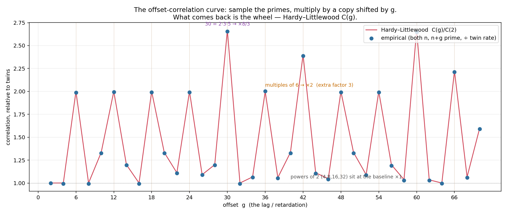
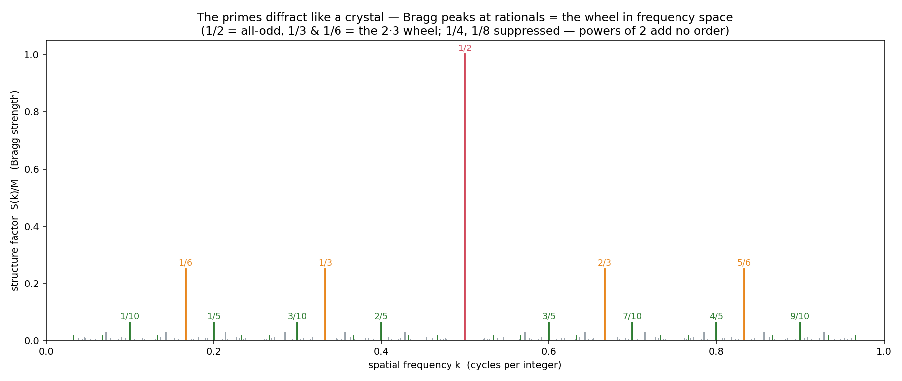
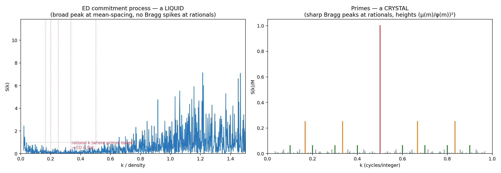

# The Prime Crystal

### The offset comb, its Fourier dual, and a control that diffracts as a liquid

Allen Proxmire

---

## Summary

- **The comb** [emp]: the rate at which $n$ and $n+g$ are both prime, relative to $g = 2$, is the Hardy–Littlewood singular series to ~1% (§1).
- **The crystal** [fact/emp]: the primes' structure factor has Bragg peaks at every rational $k = a/m$, of height exactly $(\mu(m)/\varphi(m))^2$ (§2). The two are Fourier duals.
- **The control** [emp/null]: a non-arithmetic exclusion process diffracts as a liquid, with no peaks at rationals (§3). The crystal takes divisibility, not mere exclusion.

The objects are classical — the singular series (Hardy–Littlewood 1923), the prime quasicrystal (Torquato–Zhang–de Courcy-Ireland 2018). What is added is reading both directly as the wheel, and the control.

---

## 1. The comb

Count $n \le x$ with both $n$ and $n+g$ prime — the autocorrelation $\sum_{n\le x}\Lambda(n)\Lambda(n+g)$ at lag $g$. Hardy–Littlewood predicts
$$\frac{C(g)}{C(2)} = \prod_{\substack{p \mid g \\ p > 2}} \frac{p-1}{p-2} \qquad (g \text{ even}).$$
Measured to $10^7$, every even $g \le 70$ matches to about 1%:

| $g$ | measured | $C(g)/C(2)$ | factor |
|---|---|---|---|
| 2, 4, 8, 16, 32, 64 | ≈ 1.00 | 1.000 | powers of 2 — the baseline |
| 6, 12, 18, 24, 36, 48, 54 | ≈ 1.99 | 2.000 | $3 \mid g$: $\times 2$ |
| 10, 20, 40, 50 | ≈ 1.33 | 1.333 | $5 \mid g$: $\times\frac43$ |
| 30, 60 | ≈ 2.65 | 2.667 | $\times 2 \cdot \frac43$ — the tallest teeth |
| 42 | ≈ 2.39 | 2.400 | $\times 2 \cdot \frac65$ |
| 66 | ≈ 2.21 | 2.222 | $\times 2 \cdot \frac{10}{9}$ |

The comb is the jumping-champion story as a function of lag: 6 is twice as resonant as 2, which is why 6 is the commonest gap, and 30 tops it with the extra factor from 5. The ~1% scatter about the line is the fluctuation side (pair correlation of zeros, Montgomery).



---

## 2. The crystal

Treat the primes as a point process and compute the structure factor over the $M$ primes in a window:
$$S(k) = \frac1M \left| \sum_{p \le N} e^{2\pi i k p} \right|^2 .$$
A featureless process gives $S \approx 1$; peaks that grow with $M$ are crystalline order.

**The peak law.** At $k = a/m$ in lowest terms,
$$\frac{S(a/m)}{M} = \left( \frac{\mu(m)}{\varphi(m)} \right)^2 .$$

Measured over the 148,932 odd primes below $2\times10^6$:

| $k$ | $S/M$ | $(\mu(m)/\varphi(m))^2$ |
|---|---|---|
| $1/2$ | 1.0000 | 1 |
| $1/3,\ 2/3,\ 1/6,\ 5/6$ | 0.2500 | $1/4$ |
| fifths, tenths | 0.0625 | $1/16$ |
| sevenths, fourteenths | 0.0278 | $1/36$ |
| $1/4,\ 1/8,\ 3/8$ | 0.0000 | 0 ($\mu = 0$) |

The peaks scale with $M$ — the $1/2$ peak is exactly $S = M$ — so they are true Bragg peaks. The primes have no period yet diffract like a crystal: a quasicrystal whose lattice is the wheel.

**What the peaks can and cannot see.** The height is $\mu(m)^2/\varphi(m)^2$: a squarefree indicator times $1/\varphi(m)^2$, which is the coprimality template. The *sign* of $\mu(m)$ — the Möbius-randomness, parity layer — is squared away. So $S(k)$ sees exactly the wheel and is blind to the parity barrier. The sharp peaks are the order; the diffuse background is the pseudo-randomness.

**The Fourier pair.** By Wiener–Khinchin the structure factor is the transform of the pair correlation, so the same wheel appears on both sides:

| | the comb (position) | the crystal (frequency) |
|---|---|---|
| multiples of 6 | tall teeth | peaks at $1/6, 1/3, 2/3, 5/6$ |
| factor 5 | taller teeth | peaks at fifths and tenths |
| powers of 2 | flat baseline | silence at $1/4, 1/8, \dots$ |



---

## 3. The control

**The question.** The sieve is an exclusion process: each prime forecloses its multiples. Is the Bragg signature generic to exclusion, or specific to *divisibility*?

**The control process.** A deterministic event stream with hard-core, finite-reach exclusion and no arithmetic input: a dead time plus a finite-memory AR(1) log-gap renewal, 50,000 events at mean spacing 1 (the commitment process of the Event Density framework). Both processes are finite-memory exclusion; they differ only in the kind of exclusion.

| | control process | the primes |
|---|---|---|
| low $k$ | suppressed, $S \approx 0.18$ | — |
| rational $k = a/m$ | flat, $S \approx 0.01$–$0.17$ | Bragg peaks $0.25$–$1.0$ |
| main feature | one broad peak near the mean spacing, height $O(10)$, not growing with $N$ | sharp peaks scaling with $M$ |
| verdict | a liquid | a quasicrystal |

**[emp/null]** The control is flat exactly where the primes tower. The wheel is not generic to exclusion; the "every $m$-th" divisibility rule is what turns a liquid into a crystal. Computed independently twice, with the same result. The relation of that framework to the primes is contrast, not support.



---

## Reproduction

```python
import math, numpy as np
def sieve(n):
    b=bytearray([1])*(n+1); b[0]=b[1]=0; i=2
    while i*i<=n:
        if b[i]: b[i*i::i]=bytearray(len(b[i*i::i]))
        i+=1
    return b

# §1 the comb
N=10**7; B=sieve(N); P=[i for i in range(2,N+1) if B[i]]
gs=range(2,71,2); cnt={g:0 for g in gs}
for p in P:
    if p+70>N: break
    for g in gs:
        if B[p+g]: cnt[g]+=1
def hl(g):
    r=1.0; d=3
    while g%2==0: g//=2
    while d*d<=g:
        if g%d==0:
            r*=(d-1)/(d-2)
            while g%d==0: g//=d
        d+=2
    return r*((g-1)/(g-2) if g>1 else 1)
for g in gs: print(g, round(cnt[g]/cnt[2],3), round(hl(g),3))

# §2 the crystal
B2=sieve(2_000_000); Q=np.array([i for i in range(3,2_000_001) if B2[i]],dtype=float)
SN=lambda k: abs(np.sum(np.exp(2j*np.pi*k*Q)))**2/len(Q)**2
for m in (2,3,4,5,6,7): print(m, round(SN(1/m),4))

# §3 the control
def lcg(seed):
    s=seed & 0xFFFFFFFF
    while True:
        s=(1103515245*s+12345)&0x7FFFFFFF; yield s/0x7FFFFFFF
def gen(N=50000, dead=0.3, rho=0.5, seed=12345, sig=0.55):
    u=lcg(seed); L=0.0; xs=[0.0]
    for _ in range(N-1):
        a=next(u); b=next(u)
        z=math.sqrt(-2*math.log(a+1e-12))*math.cos(2*math.pi*b)
        L=rho*L+math.sqrt(1-rho*rho)*sig*z
        xs.append(xs[-1]+dead+math.exp(L-sig*sig/2)*(1-dead))
    return np.array(xs)
X=gen(); dens=len(X)/(X[-1]-X[0])
S=lambda k: abs(np.sum(np.exp(2j*np.pi*k*X)))**2/len(X)
print([round(S(dens/m),3) for m in (2,3,4,5,6)])   # diffuse: no peaks
```

## References

- G. H. Hardy, J. E. Littlewood, *Partitio numerorum III* (1923).
- H. L. Montgomery, *The pair correlation of zeros of the zeta function* (1973).
- S. Torquato, G. Zhang, M. de Courcy-Ireland, *Uncovering multiscale order in the prime numbers via scattering*, J. Stat. Mech. (2018).
