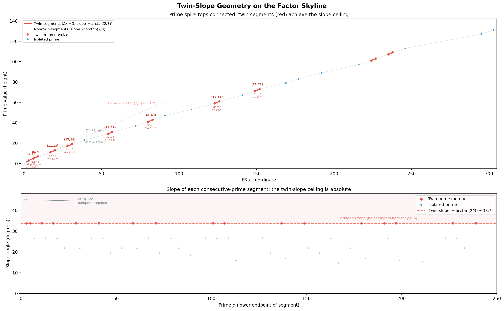
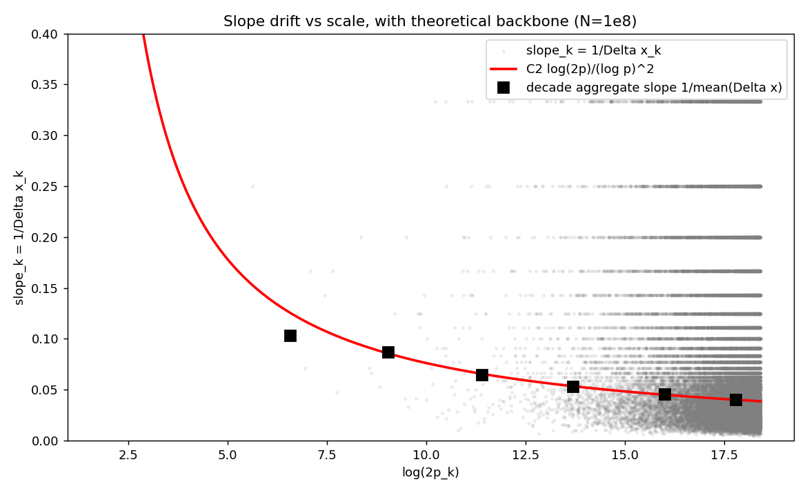

# Twin Bertrand

### A twin prime in every doubling window — the conjecture, two geometries that reach it, and its extension to other constellations

Allen Proxmire

---

## Summary

**Conjecture (Twin-Prime Bertrand Postulate, TPB).** For every real $x \ge 11$,
$$\pi_2(2x) - \pi_2(x) \ge 1, \qquad \pi_2(x) = \#\{p \le x : p,\ p+2 \text{ both prime}\}.$$

- Equivalent to $T_{k+1} < 2T_k$ for every twin $T_k \ge 11$ (§1).
- Verified to $10^{10}$: 27,412,679 twins, no exception past $T_k = 5$ (§1.3).
- Immediate under Hardy–Littlewood; open unconditionally (§1.2).
- **Epoch form:** a twin in every $[p^2, p'^2)$ between consecutive prime squares — the twin analogue of Brocard; implies TPB; verified for all 9,591 epochs below $10^{10}$ (§1.5).
- **Prime triangle:** every twin is an angle record, unconditionally; under TPB the records are *exactly* the twins, so a single non-twin record would disprove TPB. Below $10^8$ the two lists coincide: 440,312 each (§2).
- **Factor Skyline:** the slope between consecutive prime spires is capped at $\arctan\frac23$, attained iff the pair is a twin; asking that the cap be reached in every $[p,2p]$ is TPB again (§3).
- **Other constellations:** the same factor-2 inequality holds for cousins $\{0,4\}$ and sexy primes $\{0,6\}$ to $10^{10}$, with thresholds 7 and 5 (§4).

Where TPB sits:
$$\underbrace{\text{twin prime conjecture}}_{\pi_2(x)\to\infty} \;\Longleftarrow\; \underbrace{\text{TPB}}_{\pi_2(2x)-\pi_2(x)\ge1} \;\Longleftarrow\; \underbrace{\text{Hardy–Littlewood}}_{\pi_2(x)\sim 2C_2x/(\log x)^2}$$
TPB is stronger than the bounded-gaps theorems (Zhang, Maynard, Polymath), which give a short gap at *some* scales infinitely often, not a twin in *every* dyadic window.

---

## 1. The conjecture

### 1.1 Ratio form

Let $T_1 = 3 < T_2 = 5 < T_3 = 11 < \dots$ be the smaller members of twin pairs.

**Proposition 1.1.** TPB holds iff $T_{k+1} < 2T_k$ for every $k$ with $T_k \ge 11$.

*Proof.* If the ratio form holds, fix $x \ge 11$ and let $T_k$ be the largest twin $\le x$; then $T_{k+1} < 2T_k \le 2x$, so $T_{k+1} \in (x, 2x]$. Conversely, TPB at $x = T_k$ puts a twin in $(T_k, 2T_k]$, which must be $T_{k+1}$; equality $T_{k+1} = 2T_k$ is impossible since $T_{k+1}$ is odd. $\square$

### 1.2 Conditional proof

**Theorem 1.2.** If $\pi_2(x) = 2C_2\int_2^x \frac{dt}{(\log t)^2} + o\!\left(\frac{x}{(\log x)^2}\right)$ with $C_2 = \prod_{p\ge3}\frac{p(p-2)}{(p-1)^2} \approx 0.660162$, then
$$\pi_2(2x) - \pi_2(x) = (2C_2 + o(1))\frac{x}{(\log x)^2} \to \infty,$$
so TPB holds for all $x \ge x_0$. Combined with the verification below, an explicit $x_0 \le 10^{10}$ would prove TPB outright under Hardy–Littlewood.

*Proof.* $\int_x^{2x} \frac{dt}{(\log t)^2} = \frac{x}{(\log x)^2}(1+o(1))$. $\square$

No unconditional lower bound of the form $\pi_2(x) \gg x/(\log x)^A$ is known.

### 1.3 Verification to $10^{10}$

With $r_k = T_{k+1}/T_k$:

| scope | $\sup r_k$ | at $T_k$ |
|---|---|---|
| all twins | 2.200000 | $5 \to 11$ |
| $T_k > 100$ | 1.280374 | 107 |
| $T_k > 10^3$ | 1.081880 | 1,319 |
| $T_k > 10^6$ | 1.000711 | 1,122,281 |
| $T_k > 10^9$ | 1.000004 | — |

The only $r_k \ge 2$ is $5 \to 11$. Every one of the top twenty ratios occurs below $T_k = 1000$; past that, no ratio exceeds 1.09.

### 1.4 Twin-Ramanujan primes

Ramanujan's $R_n$ is the least $R$ with $\pi(x) - \pi(x/2) \ge n$ for all $x \ge R$ ($R_1 = 2$ is Bertrand's postulate). The twin analogue is
$$R^{\mathrm{twin}}_n = \min\{R : \pi_2(x) - \pi_2(x/2) \ge n \ \text{for all } x \ge R\},$$
and TPB is exactly the statement $R^{\mathrm{twin}}_1 = 11$.

| $n$ | 1 | 2 | 3 | 4 | 5 | 6 | 7 | 8 | 9 | 10 |
|---|---|---|---|---|---|---|---|---|---|---|
| $R^{\mathrm{twin}}_n$ | 11 | 59 | 101 | 149 | 179 | 227 | 569 | 599 | 641 | 809 |

| $n$ | 100 | 1,000 | 10,000 | 100,000 |
|---|---|---|---|---|
| $R^{\mathrm{twin}}_n$ | 14,009 | 217,337 | 3,241,487 | 45,529,751 |

Every $R^{\mathrm{twin}}_n$ is a twin prime, since $f(x) = \pi_2(x) - \pi_2(x/2)$ rises only at twins (checked for all $n \le 10^6$). Heuristically, from Hardy–Littlewood,
$$R^{\mathrm{twin}}_n \sim \frac{n(\log n)^2}{C_2}.$$
The same construction gives $R^{\{0,4\}}_1 = 7$ and $R^{\{0,6\}}_1 = 5$ (§4).

### 1.5 Epoch form

On the epoch $[p^2, p'^2)$ between the squares of consecutive primes, the wheel of primes $\le p$ is exact: its open slots there are the primes, and its twin-open pairs are the twin primes. The epoch form asks that every such wheel fill at least one twin-open pair inside its own epoch:
$$\pi_2(p'^2 - 2) - \pi_2(p^2 - 1) \ge 1 \qquad \text{for consecutive primes } p < p'.$$
It is the twin analogue of Brocard's conjecture (at least four primes in every epoch) and appears as the "twin recursion conjecture" in Oehlschlägel (2014). For $x \ge 625$ the window $(x, 2x]$ contains a whole epoch (two consecutive primes lie in $[\sqrt x, \sqrt{2x}]$ once $\sqrt x \ge 25$), so the epoch form implies TPB.

Verified for all 9,591 epochs below $99{,}989^2 \approx 10^{10}$ — none is empty. Against the Hardy–Littlewood count $2C_2(p'^2 - p^2)/\ln^2(p^2)$:

| $p$ | epochs | fewest twins | worst ratio | at $p$ |
|---|---|---|---|---|
| $< 100$ | 25 | 1 | 0.29 | 2 |
| $[10^2, 10^3)$ | 143 | 6 | 0.61 | 269 |
| $[10^3, 10^4)$ | 1,061 | 21 | 0.69 | 1,151 |
| $[10^4, 10^5)$ | 8,362 | 147 | 0.87 | 32,027 |

The worst ratio climbs toward 1.

**Wheel equivalences.** Let $W_p$ be the wheel of primes $\le p$. A number below $p'^2$ with no factor $\le p$ is prime, so on $(p, p'^2)$ the twin-open pairs of $W_p$ are exactly the twin primes. Hence
$$\text{TPB at } p \iff W_p \text{ has a twin-open pair in } (p, 2p], \qquad \text{epoch form} \iff W_p \text{ has a twin-open pair in } [p^2, p'^2).$$

**Why the count per turn does not settle it.** $W_p$ has $\prod_{3\le q\le p}(q-2)$ twin-open pairs per turn of $p\#$ — never zero — but the epoch is a sliver at the start of the turn ($p'^2 < p\#$ from $p = 7$), and a turn holds stretches longer than the epoch with no twin-open pair at all (108 numbers for $W_{17}$, whose epoch has 72). The same two facts hold for prime quadruplets $\{0,2,6,8\}$ — open pairs in every turn, every one found by the active wheel — yet 78 of the 228 epochs below $2.1\times10^6$ contain no quadruplet. A proof has to place twin-open pairs inside the first sliver of the turn.

**The epoch's share.** Measured against the turn-wide twin-open density $d_p = \tfrac12\prod_{3\le q\le p}(1-2/q)$, the epoch holds a fixed fraction of its wheel's average:
$$\frac{\#\{\text{twins in } [p^2, p'^2)\}}{(p'^2-p^2)\,d_p} \;\to\; \frac{e^{2\gamma}}{4} = 0.793 \qquad \text{(Hardy–Littlewood with Mertens)}.$$

| $p$ | $[10, 10^2)$ | $[10^2, 10^3)$ | $[10^3, 10^4)$ | $[10^4, 10^5)$ |
|---|---|---|---|---|
| pooled ratio | 0.831 | 0.798 | 0.795 | 0.794 |

By position $n = p^u$ the ratio is $e^{2\gamma}/u^2$: the start of the turn is rich (3.2 just past $p$), crosses the average at $u = e^\gamma = 1.78$, and the epoch sits just beyond, at $0.79$ — the twin form of Mertens' paradox ($2e^{-\gamma} = 1.123$ for single primes).

---

## 2. The prime triangle

### 2.1 Construction

To consecutive primes $p_n < p_{n+1}$ attach the right triangle with legs $p_n, p_{n+1}$, and set
$$\rho_n = \frac{p_n}{p_{n+1}}, \qquad \alpha_n = \arctan \rho_n \in (0°, 45°).$$
$\alpha$ and $\rho$ order pairs identically. For a pair of gap $g$, $1 - \rho = g/(p+g)$, so smaller gaps approach $45°$ faster and twins approach it fastest.

### 2.2 The 2P-beats lemma

**Lemma 2.1.** For prime pairs $(P, P+g)$ and $(Q, Q+h)$,
$$\rho(P, P+g) > \rho(Q, Q+h) \iff hP > gQ.$$
In particular a gap-$g$ pair beats a twin at $Q$ iff $P > \frac g2 Q$; the cheapest non-twin, $g = 4$, needs $P > 2Q$.

*Proof.* $\frac{P}{P+g} > \frac{Q}{Q+h} \iff P(Q+h) > Q(P+g) \iff hP > gQ$. $\square$

### 2.3 Angle records

A consecutive pair is an **angle record** if its $\rho$ exceeds that of every earlier pair with smaller member $\ge 3$. (Excluding $(2,3)$, whose gap is 1, keeps $(3,5)$ as the first record.)

**Proposition 2.2 (twins are always records; unconditional).** Every twin pair $(T, T+2)$ with $T \ge 3$ is an angle record.

*Proof.* Against an earlier twin $(P, P+2)$, $P < T$ gives $\frac{P}{P+2} < \frac{T}{T+2}$. Against an earlier $(P, P+g)$ with $g \ge 4$, Lemma 2.1 would need $P > \frac g2 T \ge 2T$, but $P < T$. $\square$

**Theorem 2.3 (TPB forces records to be twins).** If TPB holds, every angle record is a twin pair.

*Proof.* Let $(T_k, T_k+2)$ be a record and $(P, P+g)$, $g \ge 4$, a pair with $T_k < P < T_{k+1}$. Under TPB, $P < T_{k+1} < 2T_k \le \frac g2 T_k$, so by Lemma 2.1 it cannot beat $T_k$. The next record is therefore $T_{k+1}$. The cases $T_k \in \{3, 5\}$ are checked directly. $\square$

**Corollary 2.4.** Under TPB the record sequence *is* the twin sequence. Equivalently:
$$\text{some angle record is not a twin} \implies \text{TPB fails}.$$
A single non-twin record would be a finite, checkable counterexample.

**What is not proved: the converse.** If TPB fails at $T_k$ (so $T_{k+1} > 2T_k$), a non-twin record appears only if some consecutive pair $(P, P+g)$ in $(T_k, T_{k+1})$ satisfies
$$2P > g\,T_k.$$
Near $P \approx 2T_k$ that needs a gap of 4 — a cousin pair just past $2T_k$ — which is not guaranteed. So "every record is a twin" does not by itself imply TPB, and the record check is a *consequence* of TPB rather than an equivalent of it. TPB itself is verified directly by the ratio check of §1.3.

**Verification.** Exact integer arithmetic (cross-multiplication, no floating point) over every consecutive pair below $10^8$: **440,312 records, 440,312 twins, the two lists identical.** Zero non-twin records. The record angle climbs from $35.538°$ at $(5,7)$ to $44.99999943°$. → [`check_angle_records.py`](scripts/check_angle_records.py)

### 2.4 The prime square difference

For three consecutive primes, with $C_1 = \sqrt{p_n^2 + p_{n+1}^2}$ and $C_2 = \sqrt{p_{n+1}^2 + p_{n+2}^2}$ the two hypotenuses,
$$C_2^2 - C_1^2 = p_{n+2}^2 - p_n^2 = G_n(2p_n + G_n), \qquad G_n = p_{n+2} - p_n.$$
(The identity needs no primality; the $p_{n+1}^2$ terms cancel.)

**Theorem 2.5.** Let $\mathrm{PSD}_n = (p_{n+2}^2 - p_n^2)/12$.

1. $\mathrm{PSD}_n \in \mathbb Z$ for $p_n \ge 5$ — sharp, since $(2,3,5)$ gives $7/4$ and $(3,5,7)$ gives $10/3$.
2. For $p_n \ge 7$ the last digit of $\mathrm{PSD}_n$ is 0, 4 or 6.

*Proof.* Primes $\ge 5$ are $\equiv \pm1 \pmod 6$, and $(6b\pm1)^2 - (6a\pm1)^2 = 12(b-a)[3(a+b)\pm1]$, giving (1). For (2), every prime $\ge 7$ has $p^2 \equiv \pm1 \pmod 5$, so $p_{n+2}^2 - p_n^2 \in \{0, 48, 72\} \pmod{120}$ and $\mathrm{PSD}_n \in \{0,4,6\} \pmod{10}$. At $p_n = 5$ the mod-5 step fails: $(5,7,11)$ gives $\mathrm{PSD} = 8$. $\square$

**Distribution** (all triples below $5\times10^6$): last digit 0 at $48.97\%$, 4 and 6 at $25.51\%$ each. The 4 and 6 counts are exactly equal — they count the two directions of one mod-5 transition, which interleave. → [`check_psd.py`](scripts/check_psd.py)

**Twin specialization.** When $G_n = 6$ the middle prime is in a twin pair and $\mathrm{PSD}_n = \frac{p_n + p_{n+2}}{2} = p_{n+1} \pm 1$.

---

## 3. A second route: the slope ceiling on the Factor Skyline

### 3.1 Setting

On the Factor Skyline each integer $n$ advances the horizontal coordinate by
$$dx(n) = \begin{cases} 1 & n \text{ prime} \\ \mathrm{lpf}(n) & n \text{ composite,} \end{cases}$$
and stands at height $n$ if prime. Consecutive primes $p_i < p_{i+1}$ are joined by a segment of slope
$$\theta_i = \arctan\frac{p_{i+1} - p_i}{x_{FS}(p_{i+1}) - x_{FS}(p_i)}.$$

**Twins have horizontal gap exactly 3.** For $p \ge 5$, the one integer between $p$ and $p+2$ is even, so $\Delta x_{FS} = 2 + 1 = 3$.

### 3.2 The ceiling

**Theorem 3.1.** For consecutive primes with $p_i \ge 5$,
$$\theta_i \le \arctan\tfrac23 \approx 33.6901°,$$
with equality iff $p_{i+1} = p_i + 2$.

*Proof.* Let $g = p_{i+1} - p_i$ (even). Of the $g-1$ composites strictly between, the $g/2$ even ones contribute 2 each and the $g/2 - 1$ odd ones contribute $\mathrm{lpf} \ge 3$ each; the final prime contributes 1. So
$$\Delta x_{FS} \ge 2\cdot\tfrac g2 + 3\left(\tfrac g2 - 1\right) + 1 = \tfrac{5g}{2} - 2, \qquad \frac{g}{\Delta x_{FS}} \le \frac{2g}{5g-4}.$$
The bound $2g/(5g-4)$ is strictly decreasing in $g$, equals $\frac23$ at $g = 2$ (where $\Delta x_{FS} = 3$ exactly), and is $\frac12$ at $g=4$, tending to $\frac25$. $\square$

Verified over every consecutive-prime segment below $10^6$: maximum ratio exactly $\frac23$, attained by all 8,168 twin segments and by nothing else. Twin segments make up the entire top decile of the slope distribution.

### 3.3 Candidates never run out

A position $r$ in the $p_k\#$-template is **twin-open** if $\gcd(r, p_k\#) = \gcd(r+2, p_k\#) = 1$. When $p_{k+1}$ activates it removes 2 residue classes of $p_{k+1}$, so
$$N_{\mathrm{twin}}(p_{k+1}) = N_{\mathrm{twin}}(p_k)\,(p_{k+1} - 2): \qquad 1,\ 1,\ 3,\ 15,\ 135,\ 1485,\ \dots$$
for $p_k = 2, 3, 5, 7, 11, 13$. The expected number of twin-open positions in $[p, 2p]$ after sieving by $q \le \sqrt{2p}$ is
$$O(p) = \frac p2 \prod_{3 \le q \le \sqrt{2p}} \left(1 - \frac2q\right) \sim \frac{8C_2e^{-2\gamma}\,p}{(\ln 2p)^2} \to \infty,$$
and each survival factor $q(q-2)/(q-1)^2$ relative to independence multiplies up to $C_2$.

### 3.4 The same conjecture

Since the ceiling is attained iff the pair is a twin, "the ceiling is reached in every $[p, 2p]$" says "every $[p,2p]$ holds a twin pair" — TPB. The template guarantees ever more candidates; whether one is filled in every window is exactly what it cannot decide.

Two unrelated geometries — an angle rising toward $45°$ from below, a slope capped exactly at $\arctan\frac23$ — arrive at the same inequality. That says the conjecture is natural, not that it is true. And TPB implies the twin prime conjecture by itself; the skyline structure does no work in that implication.

---

## 4. Other constellations

### 4.1 The Generalized Bertrand Principle

For an admissible pair $\mathcal C = \{0, g\}$ (singular series $\mathfrak S(\mathcal C) > 0$), let $\pi_{\mathcal C}(x) = \#\{p \le x : p, p+g \text{ prime}\}$ and $P^{\mathcal C}_1 < P^{\mathcal C}_2 < \dots$ its members.

**Conjecture 4.1 (GBP).** For each admissible $\mathcal C$ there is a threshold $P^*_{\mathcal C}$ with
$$\pi_{\mathcal C}(2x) - \pi_{\mathcal C}(x) \ge 1 \quad (x \ge P^*_{\mathcal C}), \qquad\text{equivalently}\quad P^{\mathcal C}_{j+1} < 2P^{\mathcal C}_j \ (P^{\mathcal C}_j \ge P^*_{\mathcal C}).$$

Under Hardy–Littlewood the expected count in $(x, 2x]$ is $\sim 2\mathfrak S(\mathcal C)\,x/(\log x)^2 \to \infty$, with $\mathfrak S(\{0,2\}) = \mathfrak S(\{0,4\}) = C_2$ and $\mathfrak S(\{0,6\}) = 2C_2$.

### 4.2 Verification to $10^{10}$

| constellation | count to $10^{10}$ | violations of $r < 2$ | $P^*_{\mathcal C}$ |
|---|---|---|---|
| twin $\{0,2\}$ | 27,412,679 | 1: $5 \to 11$ | 11 |
| cousin $\{0,4\}$ | 27,409,999 | 1: $3 \to 7$ | 7 |
| sexy $\{0,6\}$ | 54,818,296 | 0 | 5 |

| scope | twin $\sup r$ | cousin $\sup r$ | sexy $\sup r$ |
|---|---|---|---|
| all | 2.200000 | 2.333333 | 1.571429 |
| $P_j > 100$ | 1.280374 | 1.283465 | 1.224299 |
| $P_j > 10^3$ | 1.081880 | 1.109790 | 1.051647 |
| $P_j > 10^6$ | 1.000711 | 1.000865 | 1.000695 |
| $P_j > 10^9$ | 1.000004 | 1.000004 | 1.000002 |

Cousins and twins agree to $0.01\%$, as $\mathfrak S(\{0,2\}) = \mathfrak S(\{0,4\})$ predicts; sexy primes run at twice the rate. Every ratio above 1.1 occurs at $P_j \le 881$.

### 4.3 The beats factor

Lemma 2.1 with $\mathcal C = \{0,g\}$ against its doubled companion $\mathcal C' = \{0, 2g\}$: a $\mathcal C'$ pair at $P$ beats a $\mathcal C$ pair at $Q$ iff $P > 2Q$, for every $g$. The dyadic factor 2 is also the universal angle-beats factor between a constellation and its doubled companion. Within the pairs of gap $\ge g$, the binding competitor is gap $g+2$ with factor $(g+2)/g$; under the ratio condition $P^{\mathcal C}_{j+1} < \frac{g+2}{g}P^{\mathcal C}_j$, every record in that restricted sequence is a $\mathcal C$ pair — again one direction only, as in §2.3.

### 4.4 Gap growth

**Mean twin gaps follow Hardy–Littlewood.** Over four decades to $10^8$,
$$\overline{G} \sim 0.792\,(\log T)^{1.978}, \qquad\text{against}\qquad \frac{(\log T)^2}{C_2} = 0.757\,(\log T)^2 .$$

**Extreme gaps grow faster than $(\log T)^2$**, alike across constellations. Per decade, $\Omega = \max G_k / (\log T^\star_k)^2$:

| decade | max $G_k$ | at $T_k$ | $\Omega$ |
|---|---|---|---|
| $10^3$ | 210 | 5,879 | 2.788 |
| $10^4$ | 630 | 62,297 | 5.169 |
| $10^5$ | 1,452 | 850,349 | 7.789 |
| $10^6$ | 1,722 | 9,923,987 | 6.635 |
| $10^7$ | 2,868 | 96,894,041 | 8.481 |
| $10^8$ | 4,770 | 698,542,487 | 11.502 |
| $10^9$ | 6,030 | 4,289,385,521 | 12.258 |

This is the twin analogue of the Cramér–Granville excess for ordinary primes. It does not threaten TPB, which needs only $G_k/T_k \to 0$. No closed-form envelope is claimed: the growth rate of $\Omega$ is not pinned by seven points.

---

## 5. The doubled-twin shadow

Place the primes on a rank axis and plot each doubled twin at $(\pi(2T_k),\ k)$. The step
$$\Delta x_k = \pi(2T_{k+1}) - \pi(2T_k) = \#\{q \text{ prime} : 2T_k < q \le 2T_{k+1}\}$$
sets the local slope $1/\Delta x_k$.

**The slope law.** From the two densities,
$$\text{slope} = \frac{dk}{d\pi(2T)} = \frac{C_2\,\log(2T)}{(\log T)^2},$$
confirmed to 1–2% across five decades (aggregate $1/\overline{\Delta x}$ falls from 0.087 to 0.040).

**The noise is the twin gaps.** Writing $\Delta x_k = 2G_k\,\hat\lambda_k$, the local density $\hat\lambda_k$ hugs $1/\log(2T_k)$ (mean ratio 0.992, spread $\pm29\%$), while $G_k$ carries essentially all the variance: $\mathrm{Var}(\log\Delta x) = 1.122$ against $\mathrm{Var}(\log 2G) = 1.142$.

**Straight runs are chance.** Equal adjacent steps occur at $1.95\%$; independent draws from the empirical (Poisson-mixture) distribution predict $\sum_v \Pr[\Delta x = v]^2 = 1.99\%$. A single Poisson of the same mean would predict $5.76\%$. The near-line is a $1/\log$ trend carrying twin-gap noise, with no periodic structure.

---

## 6. Related work

- **Ramanujan primes** — Ramanujan (1919), Sondow (2009, $R_n \sim p_{2n}$), Amersi–Beckwith–Miller–Ronan–Sondow ($c$-Ramanujan primes), Sondow–Nicholson–Noe (Ramanujan primes that happen to be twins — a different object from $R^{\mathrm{twin}}_n$). The closest prior art; no twin or constellation analogue of the dyadic threshold appears there.
- **Bounded gaps** — Zhang (2013), Maynard, Polymath8 (gap $\le 246$; 12 under Elliott–Halberstam, 6 under its generalization). Short gaps at some scales, not a twin in every window.
- **Short intervals** — Heath-Brown, Friedlander–Iwaniec, Tao–Teräväinen, Matomäki: twins in intervals $[x, x+y]$ only conditionally or for $y$ well beyond the dyadic scale.
- **Sieve bounds** — $\pi_2(x) \ll x/(\log x)^2$ unconditionally (Brun, Selberg); no matching lower bound.

The dyadic inequality $\pi_2(2x) - \pi_2(x) \ge 1$, its constellation extension, and the sequence $R^{\mathrm{twin}}_n$ do not appear to have been stated explicitly before.

---

## Reproduction

| script | reproduces |
|---|---|
| [`check_angle_records.py`](scripts/check_angle_records.py) | §2.3 — records vs twins below $10^8$, exact arithmetic |
| [`check_psd.py`](scripts/check_psd.py) | §2.4 — PSD integrality, last digits, distribution |
| [`check_envelope_fits.py`](scripts/check_envelope_fits.py) | §4.4 — mean twin-gap growth |
| [`pg_extend_1e10.py`](scripts/pg_extend_1e10.py), [`pg_structural_1e10.py`](scripts/pg_structural_1e10.py) | §1.3, §4.2 — the $10^{10}$ sieve |
| [`pg_twin_ramanujan.py`](scripts/pg_twin_ramanujan.py) | §1.4 — $R^{\mathrm{twin}}_n$ |
| [`check_epoch_twins.py`](scripts/check_epoch_twins.py) | §1.5 — twins in every epoch $[p^2, p'^2)$ below $10^{10}$ (numpy, ~2 min) |
| [`check_epoch_share.py`](scripts/check_epoch_share.py) | §1.5 — the epoch share $e^{2\gamma}/4$, the position profile, the quadruplet check (run after `check_epoch_twins.py`) |
| [`pg_twin_angle_analysis.py`](scripts/pg_twin_angle_analysis.py), [`pg_deltax_unified.py`](scripts/pg_deltax_unified.py) | §1.3, §5 |

Verification reports: [`results/`](results/).

## References

- J. Oehlschlägel, *Reasoning about Primes (II)*, arXiv:1411.6582 (2014) — Conjecture 4.1.

- G. H. Hardy, J. E. Littlewood, *Some problems of 'Partitio numerorum' III*, Acta Math. **44** (1923).
- S. Ramanujan, *A proof of Bertrand's postulate*, J. Indian Math. Soc. **11** (1919).
- J. Sondow, *Ramanujan primes and Bertrand's postulate*, Amer. Math. Monthly **116** (2009).
- J. Sondow, J. W. Nicholson, T. D. Noe, *Ramanujan primes: bounds, runs, twins, and gaps*, J. Integer Seq. **14** (2011).
- N. Amersi et al., *Generalized Ramanujan primes*, Springer Proc. Math. Stat. **101** (2014).
- Y. Zhang, *Bounded gaps between primes*, Ann. Math. **179** (2014); J. Maynard, *Small gaps between primes*, Ann. Math. **181** (2015).
- H. L. Montgomery, K. Soundararajan, *Primes in short intervals*, Comm. Math. Phys. **252** (2004).
- A. Proxmire, *The Factor Skyline*, Zenodo (2026), DOI [10.5281/zenodo.18275273](https://doi.org/10.5281/zenodo.18275273).
