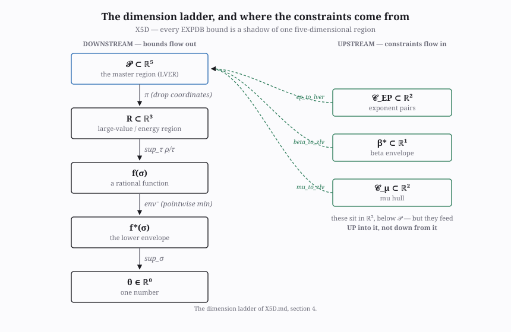
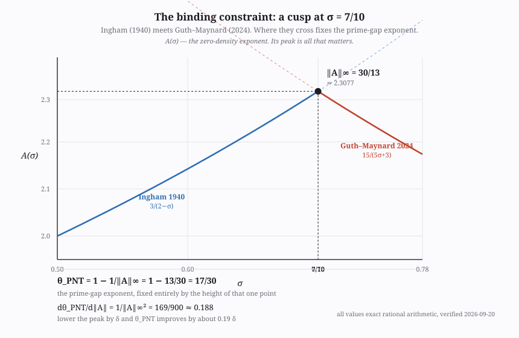

# X5D: The Exponent Database as Geometry

### One five-dimensional region, three operations, and two worked numbers

Allen Proxmire

---

## Summary

The Analytic Number Theory Exponent Database (EXPDB; Tao, Trudgian, Yang 2025) is a Python pipeline, about 10,700 lines in 24 modules, that turns literature estimates — exponent pairs, $\beta$ and $\mu$ bounds, large value estimates, zero density and additive-energy estimates — into the best bounds derivable from them. It is written procedurally: call a transform, intersect, project, repeat.

**What goes in.** The database and its five-dimensional region $\mathcal E$ of exponent tuples $(\sigma, \tau, \rho, \rho^*, s)$ are Tao–Trudgian–Yang's. Every estimate is theirs or the literature's. Nothing here is a new estimate in analytic number theory.

**What comes out.**
- A geometric reading of the whole downstream pipeline: every downstream bound is obtained from the computed region $\mathcal P \subset \mathbb R^5$ (the database's current outer approximation of $\mathcal E$) by three operations — **projection, rational supremum, lower envelope** — descending $\mathbb R^5 \to \mathbb R^3 \to \mathbb R^1 \to \mathbb R^0$ (§2–§4).
- The iteration as a monotone descent on a product lattice that stabilizes at the tightest bounds derivable from the given axioms and transforms (§5).
- Two worked numbers, both checked exactly by [`repro/check_x5d_arithmetic.py`](repro/check_x5d_arithmetic.py) (§6):
  - the Ingham / Guth–Maynard cusp at $\sigma = \frac{7}{10}$, which gives $\theta_{\mathrm{PNT}} \le \frac{17}{30}$ — Guth and Maynard's result, read off the picture;
  - a property of the database's second-moment prime-gap route: its output is **not monotone** in the zero-density input, so near $\sigma = 1$ a chosen, weaker input does better than the pointwise-best one the code feeds in — $\frac54$ at best, against the code's $\frac32$. The best known bound for that exponent is $\frac{123}{100}$ (Stadlmann).

---

## 1. The objects

| object | space | what it is |
|---|---|---|
| exponent-pair hull $\mathcal C_{\mathrm{EP}}$ | $\mathbb R^2$ | convex hull of the known pairs $(k, l)$, closed under the A, B, C processes |
| $\beta^*(\alpha)$ | $\mathbb R^1$ | $\min_i\{(l_i - k_i)\alpha + k_i\}$, the dual envelope of the hull |
| $\mu$ hull $\mathcal C_\mu$ | $\mathbb R^2$ | lower hull of $(\sigma, \mu(\sigma))$ bounds |
| LV, ZLV regions | $\mathbb R^3$ | feasible $(\sigma, \tau, \rho)$ for large values of Dirichlet / zeta polynomials |
| energy region (LV$^*$) | $\mathbb R^3$ | feasible $(\sigma, \tau, \rho^*)$ |
| $\mathcal P$ (LVER) | $\mathbb R^5$ | feasible $(\sigma, \tau, \rho, \rho^*, s)$ |
| $A(\sigma)$, $A^*(\sigma)$ | $\mathbb R^1$ | zero density and zero density energy exponents: $N(\sigma, T) \ll T^{A(\sigma)(1-\sigma) + o(1)}$ |
| $\theta$ | $\mathbb R^0$ | a prime-gap exponent (§6) |

The coordinates: $\sigma \in [\frac12, 1]$ is the primary parameter, $\tau$ the length scale, $\rho$ the large-value exponent, $\rho^*$ the additive-energy exponent, and $s$ an auxiliary exponent through which the Heath-Brown, Ivić and Guth–Maynard joint estimates couple $\rho$ and $\rho^*$. Four coordinates are too few to state those joint estimates; no estimate in the database needs a sixth.

---

## 2. The region

### 2.1 Construction

Start from the box
$$\mathcal B = [\tfrac12, 1] \times [0, 10^6] \times [0, 10^6]^3 \subset \mathbb R^5$$
(the code's `TAU_UPPER_LIMIT` and `LV_DEFAULT_UPPER_BOUND`) and intersect with rational half-spaces
$$c_0 + c_1\sigma + c_2\tau + c_3\rho + c_4\rho^* + c_5 s \ge 0, \qquad c_i \in \mathbb Q,$$
from five sources:

1. **Direct joint estimates** (Heath-Brown, Ivić, Guth–Maynard; about 15–20 hypotheses, 3–9 half-spaces each). Example, Heath-Brown:
$$s \le \min\bigl(2 + \rho,\ 1 + 2\rho,\ 1 + \tfrac12\tau + \tfrac54\rho\bigr).$$
2. **Lifted large value estimates:** a region $R \subset \mathbb R^3$ in $(\sigma, \tau, \rho)$ becomes $R \times [0, M]^2$.
3. **Lifted $\beta$ and $\mu$ bounds:** $\beta(\alpha) \le m\alpha + c$ gives $\sigma - c\tau - m \ge 0$ on $\tau \in [1/\alpha_1, 1/\alpha_0]$; $\mu(\sigma_0) \le \mu_0$ gives $\sigma - \sigma_0 - \mu_0\tau \ge 0$; both lifted.
4. **Exponent-pair constraints:** each pair $(k, l)$ gives nine half-spaces whose coefficients involve $\frac{k+l}{1+2k+2l}$ and $\frac{2+3k+4l}{1+2k+2l}$.
5. **Raising to a power:** $(\sigma, \tau, \rho, \rho^*, s) \mapsto (\sigma, k\tau, k\rho, k\rho^*, ks)$ for $k = 2, 3, 4$ (occasionally 5).

Intersected over a $(\sigma, \tau)$ domain $\mathcal D$, this is exactly what `compute_best_lver` returns:
$$\mathcal P(\mathcal H, \mathcal D) = (\mathcal D \times [0, M]^3) \cap \bigcap_{R \in \mathcal L} R ,$$
a finite union of convex polytopes with disjoint interiors.

### 2.2 Properties

All immediate from the construction:
- **rational** — every vertex has rational coordinates;
- **bounded** — $\mathcal P \subseteq \mathcal B$;
- **a union of convex pieces**, not convex in general; the pieces carry the dependency labels from which proof trees are built;
- **monotone** — more hypotheses give a smaller region, a larger domain a larger one:
$$\mathcal H_1 \subseteq \mathcal H_2 \Rightarrow \mathcal P(\mathcal H_2, \mathcal D) \subseteq \mathcal P(\mathcal H_1, \mathcal D), \qquad \mathcal D_1 \subseteq \mathcal D_2 \Rightarrow \mathcal P(\mathcal H, \mathcal D_1) \subseteq \mathcal P(\mathcal H, \mathcal D_2).$$

In practice the database builds a finite **family** $\mathcal P^{(i)} = \mathcal P(\mathcal H, \mathcal D_i)$, one per call of `prove_zero_density` with its own domain and splitting parameter $\tau_0$; "$\mathcal P$" below means any member, and envelopes are taken over the family.

---

## 3. Three operations

**Projection** drops coordinates:
$$R_{\mathrm{LV}} = \pi_{\sigma\tau\rho}(\mathcal P), \qquad R_{\mathrm{energy}} = \pi_{\sigma\tau\rho^*}(\mathcal P).$$

**Rational supremum** collapses a three-dimensional shadow to a function of $\sigma$:
$$\Phi_{\rho/\tau}(R)(\sigma) = \sup\{\rho/\tau : (\sigma, \tau, \rho) \in R,\ \tau > 0\}.$$
On each convex piece the supremum of the linear-fractional $\rho/\tau$ is attained on an edge; along an edge $\tau$ and $\rho$ are affine in $\sigma$, so the edge contributes $(c\sigma + d)/(a\sigma + b)$. $\Phi$ is the upper envelope of finitely many such pieces — piecewise rational, with breakpoints at roots of quadratics (algebraic, not in general rational).

**Lower envelope** takes the pointwise minimum over all derivation routes.

**The downstream outputs.**
$$A(\sigma) = \mathrm{env}^-\Bigl(\ \bigl\{\mathrm{env}^+\bigl(\Phi_{\rho/\tau}\,\pi_{\sigma\tau\rho}(\mathcal P^{(i)}),\ \Phi_{\rho/\tau}\,\pi_{\sigma\tau\rho}(\mathcal P^{(i)}_\zeta)\bigr)\bigr\}_i,\ \ A_{\mathrm{EP}},\ \ A_{\mathrm{lit}}\Bigr)$$
$$A^*(\sigma) = \mathrm{env}^-\Bigl(\ \Bigl\{\tfrac{1}{1-\sigma}\,\mathrm{env}^+\bigl(\Phi_{\rho^*/\tau}\,\pi_{\sigma\tau\rho^*}(\mathcal P^{(i)}),\ \Phi_{\rho^*/\tau}\,\pi_{\sigma\tau\rho^*}(\mathcal P^{(i)}_\zeta)\bigr)\Bigr\}_i,\ \ A^*_{\mathrm{lit}}\Bigr)$$
where $\mathcal P_\zeta$ adds $\tau \ge 2$ and the zeta-specific estimates, the upper envelope takes the worse of the two $\tau$-ranges, $A_{\mathrm{lit}}, A^*_{\mathrm{lit}}$ are literature estimates, and $A_{\mathrm{EP}}$ are closed-form routes from exponent pairs that **bypass** $\mathcal P$:
$$A(\sigma) \le \frac{3m}{(3m-2)\sigma + 2 - m} \ \ \text{(Ivić)}, \qquad A(\sigma) \le \frac{4k}{2(1+k)\sigma - 1 - l} \ \ \text{(Bourgain)}.$$
The 3D routes (`lv_zlv_to_zd`, `lv_zlv_to_zd2`) work from the LV and ZLV regions directly; the 5D route (`lver_to_zd`) is stronger whenever the joint estimates of source 1 or 4 are active.

So the precise statement is: **the LV, ZLV and energy regions are projections of $\mathcal P$; $A$ and $A^*$ are lower envelopes of rational suprema of those projections together with a few closed-form routes; the upstream objects ($\mathcal C_{\mathrm{EP}}$, $\beta^*$, $\mathcal C_\mu$) do not descend from $\mathcal P$ but generate constraints on it.** One may replace a piece-union by its convex hull for drawing, but not for computing: a section of $\mathrm{conv}(\mathcal P)$ at fixed $\sigma$ can exceed the section of $\mathcal P$, so the rational supremum can change.

---

## 4. The dimension ladder

$$\mathcal P \subset \mathbb R^5 \xrightarrow{\ \pi\ } R \subset \mathbb R^3 \xrightarrow{\ \sup_\tau \rho/\tau\ } f(\sigma) \xrightarrow{\ \mathrm{env}^-\ } A(\sigma) \xrightarrow{\ \sup_\sigma\ } \theta \in \mathbb R$$

$\mathbb R^2$ is absent from the descending chain: the exponent-pair hull, $\beta^*$ and $\mu$ hull sit in $\mathbb R^2$ and flow *up* into $\mathcal P$ (via `ep_to_lver`, `beta_to_zlv`, `mu_to_zlv`).

**Each step loses information.** Two regions differing only in constraints on $s$ can have the same LV and energy projections, so the projections do not determine $\mathcal P$; and many regions share one rational supremum. Lifting and projection form a Galois connection,
$$\pi_{\sigma\tau\rho}(Q) \subseteq R \iff Q \subseteq R \times [0, M]^2 ,$$
and the gap $\mathcal P \subsetneq \pi_{\sigma\tau\rho}(\mathcal P) \times [0, M]^2$ is exactly the content of the joint estimates that couple $\rho$ and $\rho^*$ through $s$.

**Dualities among the upstream objects.**
- *Exponent pairs ↔ $\beta$* (point–line, Legendre–Fenchel): the pair $(k, l)$ gives the line $\beta = (l - k)\alpha + k$; an edge of $\beta^*$ with slope $m$ and intercept $c$ gives the pair $(c, m + c)$. Hull vertices biject with envelope pieces; the round trip can create new pairs, which is the feedback loop.
- *Exponent pairs ↔ $\mu$*: the linear map $(k, l) \mapsto (l - k, k)$.

---

## 5. The iteration

Write the state as the tuple $\Sigma = (\mathcal C_{\mathrm{EP}}, \beta^*, \mathcal C_\mu, R_{\mathrm{LV}}, R_{\mathrm{ZLV}}, \mathcal P, A, A^*, \theta)$, ordered componentwise by "tighter" (larger hulls; smaller regions; lower functions). One pass of the pipeline is an operator $\Phi$: expand the hull by A, B, C and by $\beta \to$ EP duality; refine $\beta^*$ (EP lines, the D-process, van der Corput); refine the $\mu$ hull; rebuild the regions; recompute $A$, $A^*$, $\theta$.

- **Descent.** Every stage only adds points to hulls, adds half-spaces to regions, or adds candidates to lower envelopes, so $\Phi(\Sigma) \preceq \Sigma$ on reachable states, and $\Phi$ is order-preserving on the region, hull and envelope components.
- **Stabilization.** The code bounds every loop (`EXP_PAIR_TRUNCATION = BETA_TRUNCATION = LARGE_VALUES_TRUNCATION = 20`, raise-to-power $k \le 5$) and draws half-spaces from a finite pool, so a reachable descending chain is finite and the iteration reaches $\Sigma^* = \Phi(\Sigma^*)$.
- **Meaning.** $\Sigma^*$ is the tightest state derivable from the given axioms with the implemented transforms — not optimal in any absolute sense. Huxley subdivision, for example, is declared but not implemented (`NotImplementedError`).

Two cautions. The final stage maps $(A, A^*)$ to $\theta$ through rational functions that are **not monotone in $A$** (§6.2), so "tighter inputs give a tighter $\theta$" is false for that stage. And stabilization relies on the truncations; without them the exponent-pair hull can keep acquiring vertices.

---

## 6. Two worked numbers

### 6.1 The cusp and $\theta_{\mathrm{PNT}} \le 17/30$

For primes in all short intervals, $\theta_{\mathrm{PNT}} \le 1 - 1/\lVert A\rVert_\infty$ with $\lVert A\rVert_\infty = \sup_{1/2 \le \sigma \le 1} A(\sigma)$ (Ingham; Tao–Trudgian–Yang Prop. 15.4). On the envelope the supremum sits where Ingham (1940) meets Guth–Maynard (2024):
$$A_{\mathrm{Ing}}(\sigma) = \frac{3}{2-\sigma}\ \text{(increasing, binding on } [\tfrac12, \tfrac{7}{10})\text{)}, \qquad A_{\mathrm{GM}}(\sigma) = \frac{15}{5\sigma+3}\ \text{(decreasing, binding on } [\tfrac{7}{10}, \tfrac{19}{25})\text{)},$$
$$A_{\mathrm{Ing}}(\tfrac{7}{10}) = A_{\mathrm{GM}}(\tfrac{7}{10}) = \frac{30}{13}.$$
Hence
$$\theta_{\mathrm{PNT}} \le 1 - \frac{13}{30} = \frac{17}{30}, \qquad \theta_{\mathrm{PNT\text{-}AA}} \le 1 - \frac{2}{\lVert A\rVert_\infty} = \frac{2}{15}, \qquad \frac{d\theta_{\mathrm{PNT}}}{d\lVert A\rVert_\infty} = \frac{1}{\lVert A\rVert_\infty^2} = \frac{169}{900}.$$
These are Guth and Maynard's bounds (Tao–Trudgian–Yang Cor. 15.6). What the picture adds is where they come from: the whole five-dimensional apparatus locates one point, and its height is the exponent; lowering the peak by $\delta$ lowers $\theta_{\mathrm{PNT}}$ by about $0.19\,\delta$. Before Guth–Maynard the peak was the Ingham–Huxley crossing, $3/(2-\sigma) = 3/(3\sigma - 1)$ at $\sigma = \frac34$, height $\frac{12}{5}$, giving $\frac{7}{12}$.

### 6.2 The second-moment route is not monotone

The exponent $\theta_{\mathrm{gap},2}$ is the least $\theta$ with
$$\sum_{p_n \le x} (p_{n+1} - p_n)^2 \ll x^{\theta + o(1)} .$$
Its database route (`compute_gap2`; Heath-Brown 1979, Lemma 2; Tao–Trudgian–Yang Prop. 15.9): for any upper bounds $A(\sigma)$ and $B(\sigma)$ on the zero density and zero density energy exponents,
$$\theta_{\mathrm{gap},2} \le \max\Bigl(2 - \frac{2}{\lVert A\rVert_\infty},\ \sup_{1/2 \le \sigma \le 1}\max\bigl(\alpha(\sigma), \beta(\sigma)\bigr)\Bigr),$$
$$\alpha(\sigma) = 4\sigma - 2 + \frac{2\bigl(B(\sigma)(1-\sigma) - 1\bigr)}{B(\sigma) - A(\sigma)}, \qquad \beta(\sigma) = 4\sigma - 2 + \frac{B(\sigma)(1-\sigma) - 1}{A(\sigma)} .$$

**The non-monotonicity.** Where $B > A > 0$ and $B(1-\sigma) < 1$ — which holds near $\sigma = 1$ — a *larger* (weaker) $A$ gives a *smaller* $\alpha$:
$$\frac{\partial\alpha}{\partial A} = \frac{2\bigl(B(1-\sigma) - 1\bigr)}{(B - A)^2} < 0 .$$
As $\sigma \to 1$ with $B \to B_1$,
$$A \to 0:\ \ \alpha \to 2 - \frac{2}{B_1}, \qquad A \to A_1 > 0:\ \ \alpha \to 2 - \frac{2}{B_1 - A_1} .$$
The database's code (`compute_gap2` in `prime_gap.py`) feeds in the pointwise-best $A$ from its envelope. If that $A$ decays to zero at $\sigma = 1$, then with Heath-Brown's energy bound $B(\sigma) = \frac{12}{4\sigma - 1}$, $B_1 = 4$, it gets
$$\alpha \to 2 - \tfrac24 = \tfrac32 .$$

**Is "any upper bound" the lemma's real reading?** The database states the proposition for any upper bounds $A, B$, with no side conditions, and its own proofs use that freedom: under the Lindelöf hypothesis it takes $A(\sigma) = B(\sigma) = \varepsilon$ for $\sigma > \frac34$ (Cor. 15.10(ii), giving $\frac76$), and the unconditional $\frac{23}{18}$ (Cor. 15.10(iii), Heath-Brown) comes from the same proposition with chosen bounds on $A$. A consistency test supports that reading. With only the inputs available in 1979 — Ingham $\frac{3}{2-\sigma}$, Huxley $\frac{3}{3\sigma-1}$, a bound decaying like $\sqrt{1-\sigma}$, and Heath-Brown's energy bounds — choosing $A$ freely gives about $1.31$. That is no better than Heath-Brown's own $\frac{23}{18}$ and nowhere near beating today's $\frac{123}{100}$, so nothing too good to be true comes out. Feeding the pointwise-best $A$ instead gives about $1.49$. Heath-Brown's 1979 paper itself was not available to check line by line.

**The best choice at the endpoint.** As $\sigma \to 1$ with $A \to A_1$ and $B \to B_1$,
$$\alpha \to 2 - \frac{2}{B_1 - A_1}, \qquad \beta \to 2 - \frac{1}{A_1}.$$
$\alpha$ falls and $\beta$ rises as $A_1$ grows, so the larger of the two is smallest where they meet:
$$\frac{2}{B_1 - A_1} = \frac{1}{A_1} \iff A_1 = \frac{B_1}{3}, \qquad \lim \max(\alpha, \beta) = 2 - \frac{3}{B_1} = \frac54 \quad (B_1 = 4).$$
$A = \frac43$ is a valid upper bound near $\sigma = 1$, because the database's own estimates fall below it: $\frac{3}{10\sigma - 7} \le \frac43$ for $\sigma \ge \frac{37}{40}$, and Bourgain's $\frac{6}{303\sigma - 290} \le \frac43$ for $\sigma \ge \frac{589}{606}$. Choosing $A$ freely on $[\frac{59}{60}, 1)$ gives a supremum of about $1.250$ (numerical).

**The note's choice.** Heath-Brown's exponent pair with $m = 6$,
$$(k, l) = \Bigl(\frac{2}{(m-1)^2(m+2)},\ 1 - \frac{3m-2}{m(m-1)(m+2)}\Bigr) = \Bigl(\frac{1}{100}, \frac{14}{15}\Bigr),$$
meets Bourgain's conditions $k < \frac15$, $l > \frac35$, $15l + 20k = \frac{71}{5} > 13$, $k \le \frac{11}{85}$, so for $\sigma > \frac{l+1}{2(k+1)} = \frac{290}{303}$,
$$A(\sigma) \le \frac{4k}{2(1+k)\sigma - 1 - l} = \frac{6}{303\sigma - 290}, \qquad A(1^-) = \frac{6}{13} .$$
With this $A$ and $B = \frac{12}{4\sigma - 1}$ on $[\frac{59}{60}, 1)$:
$$\alpha(\sigma) = \frac{2376\sigma^2 - 1981\sigma - 296}{3(602\sigma - 579)}, \qquad \beta(\sigma) = \frac{-4752\sigma^2 + 8507\sigma - 3758}{6(4\sigma - 1)} .$$
$\alpha$ rises from $\alpha(\frac{59}{60}) = \frac{16043}{11670} \approx 1.375$ to
$$\lim_{\sigma \to 1^-}\alpha(\sigma) = \frac{33}{23} = 2 - \frac{2}{4 - 6/13} \approx 1.4348,$$
with $\beta < \alpha$ throughout. That beats the code's $\frac32$ on this interval, but it is not the best choice: $A_1 = \frac{6}{13}$ is below the balancing value $\frac43$.

**What this is and is not.** The route rewards choosing the zero-density input rather than feeding in the pointwise-best one — Heath-Brown and the database's authors do this in their proofs, but the code's automatic run does not. Near $\sigma = 1$ the best choice gives $\frac54$. Nothing here is a new bound on $\theta_{\mathrm{gap},2}$. The full route depends on every interval of $[\frac12, 1]$; the database's interval values (about $1.375$ on $[\frac{41}{42}, \frac{59}{60})$, from a database run) were not recomputed with free $A$, because the code needs `sympy` and `pycddlib`, which are not installed here. The known bounds are $\frac{23}{18}$ (Heath-Brown) and $\frac{123}{100}$ (Stadlmann).

All closed forms in this section are verified as exact rational arithmetic by [`repro/check_x5d_arithmetic.py`](repro/check_x5d_arithmetic.py).

---

## 7. Directions

- **Optimise the $\theta_{\mathrm{gap},2}$ route over admissible inputs** (§6.2): choose $A(\sigma)$ on every interval, not only at the endpoint, and see whether the route reaches or passes $\frac{23}{18}$ with today's estimates.
- **Huxley subdivision**, declared but unimplemented, would add a transform and could tighten the fixed point.
- **Choose $\tau_0$ automatically.** The splitting parameter is set by hand in each `prove_zero_density` call; optimising it is a parametric linear-fractional program.
- **Load-bearing hypotheses.** A hypothesis matters to $\theta$ only if it contributes an active half-space on the path to the critical $\sigma$; the dependency labels already identify these. The minimal such set — the essential axioms — is open.
- **Complexity.** $\mathcal P$ has $O(n)$ facets for $n$ hypotheses, so by the upper bound theorem each piece has $O(n^{\lfloor 5/2\rfloor}) = O(n^2)$ vertices. Whether the database's structure does better is open.
- **The exponent-pair loop in closed form.** The fixed hull satisfies a finite algebraic system; solving it directly instead of iterating is open.

---

## Appendix. Where each operation lives in the code

| operation | function | module |
|---|---|---|
| build $\mathcal P$ | `compute_best_lver` | `additive_energy.py` |
| lift LV to LVER | `lv_to_lver` | `additive_energy.py` |
| exponent pair to LVER | `ep_to_lver` | `additive_energy.py` |
| raise to a power | `get_raise_to_power_hypothesis` | `additive_energy.py` |
| $\beta$, $\mu$ to ZLV | `beta_to_zlv`, `mu_to_zlv` | `zeta_large_values.py` |
| projection, lift, scaling | `Polytope.project`, `.lift`, `.scale_all` | `polytope.py` |
| piece unions | `Region.from_union_of_halfplanes`, `.as_disjoint_union` | `region.py` |
| rational supremum | `compute_sup_rho_on_tau`, `compute_sup_LV_on_tau` | `zero_density_estimate.py`, `zero_density_energy_estimate.py` |
| zero density routes | `lv_zlv_to_zd`, `lv_zlv_to_zd2`, `lver_to_zd`, `ivic_ep_to_zd`, `bourgain_ep_to_zd` | `zero_density_estimate.py` |
| lower envelopes | `best_zero_density_estimate`, `compute_best_energy_bound` | `zero_density_estimate.py`, `zero_density_energy_estimate.py` |
| energy route | `lver_to_energy_bound` | `zero_density_energy_estimate.py` |
| $\theta_{\mathrm{gap},2}$ | `compute_gap2` | `prime_gap.py` |
| exponent-pair hull, $\beta \to$ EP | `compute_exp_pairs`, `compute_convex_hull` | `exponent_pair.py` |
| $\beta$ envelope | `compute_best_beta_bounds` | `bound_beta.py` |
| $\mu$ hull | `best_mu_bound` | `bound_mu.py` |
| orchestration | `prove_all`, `prove_zero_density`, `prove_prime_gap2` | `derived.py` |

---

## References

- T. Tao, T. Trudgian, A. Yang, *New exponent pairs, zero density estimates, and zero additive energy estimates: a systematic approach*, arXiv:2501.16779 (2025); database and blueprint at [teorth.github.io/expdb](https://teorth.github.io/expdb/).
- L. Guth, J. Maynard, *New large value estimates for Dirichlet polynomials* (2024).
- A. E. Ingham, *On the estimation of N(σ, T)*, Quart. J. Math. **11** (1940).
- M. N. Huxley, *On the difference between consecutive primes*, Invent. Math. **15** (1972).
- D. R. Heath-Brown, *The differences between consecutive primes, II*, J. London Math. Soc. (2) **19** (1979).
- D. R. Heath-Brown, *A new kth derivative estimate for exponential sums via Vinogradov's mean value*, Proc. Steklov Inst. Math. **296** (2017).
- J. Bourgain, *On large values estimates for Dirichlet polynomials and the density hypothesis for the Riemann zeta function*, IMRN (1995).
- A. Ivić, *The Riemann Zeta-Function*, Wiley (1985).
- J. Stadlmann, on the second moment of prime gaps (2022), as tabulated in the database blueprint, §15.
