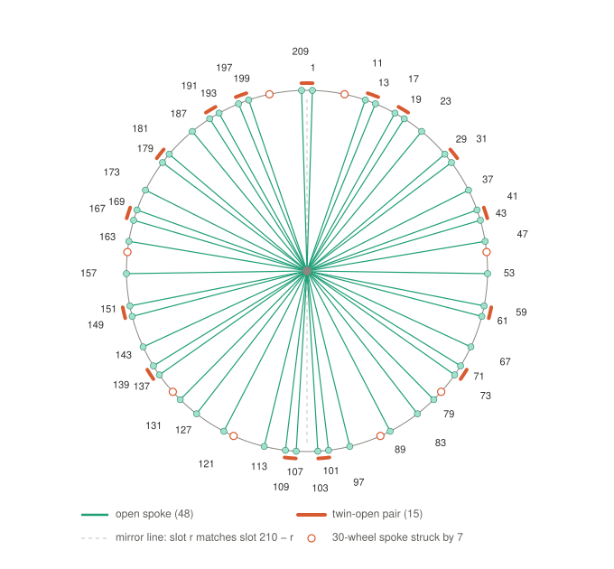

# Visuals

Drawn by [`gen_wheels.py`](gen_wheels.py), standard library only.

## `wheel_30.svg` — the 30-wheel

Clocks 2, 3, 5. Eight open spokes at 1, 7, 11, 13, 17, 19, 23, 29 — every slot none of the three strikes. The wheel is a mirror: slot $r$ is open exactly when $30 - r$ is. Three twin-open pairs: 11/13 and 17/19 mirror each other, and 29/1 sits on the seam and mirrors itself. Rolled forward, the spokes land on 31, 37, 41, 43, 47, 49, 53, 59; the first open number that is not prime is 49 = 7², where the 7-clock joins.

## `wheel_210.svg` — the 210-wheel

Clocks 2, 3, 5, 7. Forty-eight open spokes and fifteen twin-open pairs, $\prod_{3\le q\le 7}(q-2) = 15$ — seven on each side of the mirror and one on the seam (209/1). The hollow marks are the eight 30-wheel spokes the 7-clock strikes: 7, 49, 77, 91, 119, 133, 161, 203.
