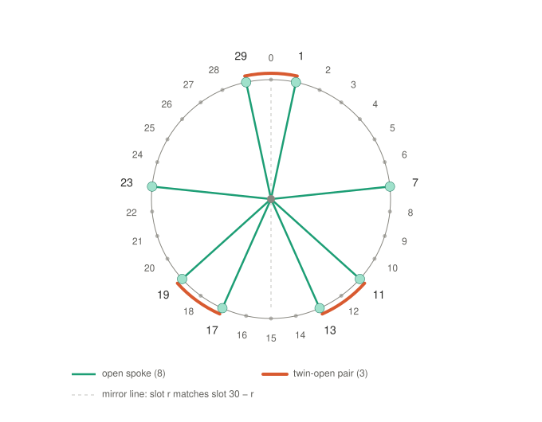
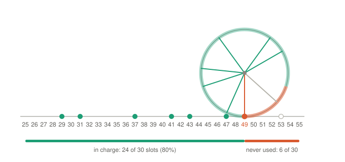
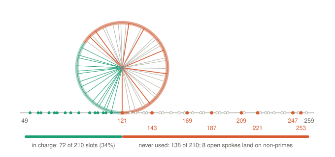

# Visuals

Drawn by [`gen_wheels.py`](gen_wheels.py) and [`gen_rolls.py`](gen_rolls.py), standard library only.

## `wheel_30.svg` — the 30-wheel

The 2-3-5-wheel, or 30-wheel. Eight open spokes at 1, 7, 11, 13, 17, 19, 23, 29 — every slot none of the three strikes. The wheel is a mirror: slot $r$ is open exactly when $30 - r$ is. Three twin-open pairs: 11/13 and 17/19 mirror each other, and 29/1 sits on the seam and mirrors itself. Rolled forward, the spokes land on 31, 37, 41, 43, 47, 49, 53, 59; the first open number that is not prime is 49 = 7², where the 7-wheel joins.

## `wheel_210.svg` — the 210-wheel

The 2-3-5-7-wheel, or 210-wheel. Forty-eight open spokes and fifteen twin-open pairs, $\prod_{3\le q\le 7}(q-2) = 15$ — seven on each side of the mirror and one on the seam (209/1). The hollow marks are the eight 30-wheel spokes the 7-wheel marks: 7, 49, 77, 91, 119, 133, 161, 203.

## `wheel_30_roll.svg` — the 30-wheel's stretch

The 30-wheel takes charge at 25 = 5² and rolls to 49 = 7², where the 7-wheel joins: 24 of its 30 slots, 0.8 of a turn. Every open spoke on the way lands on a prime (29, 31, 37, 41, 43, 47). The last fifth of the rim is never used; its first open spoke lands on 49 = 7 × 7.

## `wheel_210_roll.svg` — the 210-wheel's stretch

The 210-wheel takes charge at 49 and is exact to 121 = 11²: 72 of its 210 slots, about a third of a turn, catching all fifteen primes there. Rolled on through the rest of the turn it goes wrong: eight open spokes land on non-primes — 121, 143, 169, 187, 209, 221, 247, 253 — each a product of the primes 11 to 23 that have not yet joined. The hollow marks are the primes it still finds.
